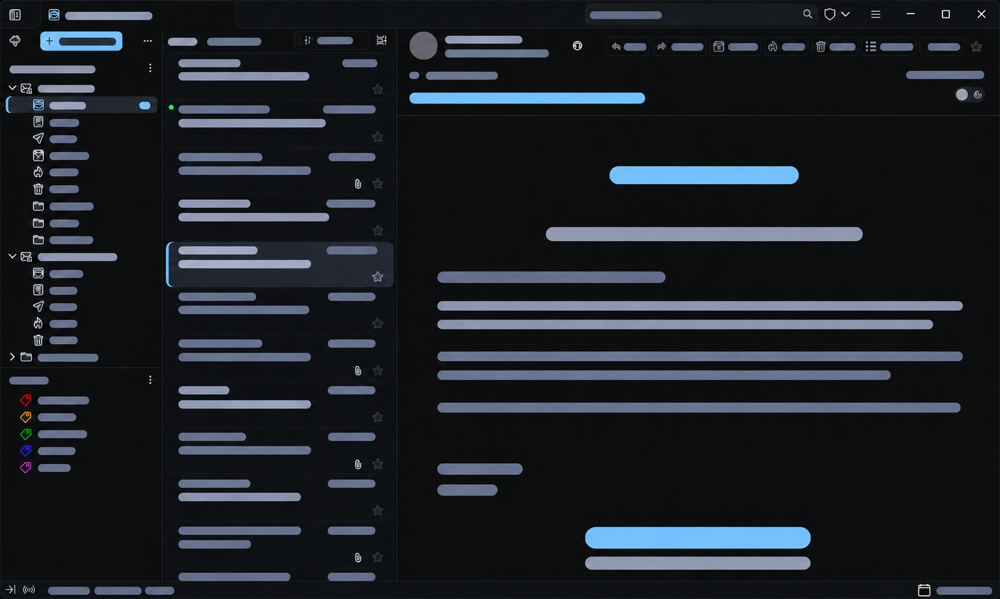

# Arctic Bird

A refined dark CSS theme for **Betterbird and Thunderbird**, designed around near-black surfaces, quiet separators, monochrome icons and restrained blue accents. The Arctic palette comes from **Brackets Refined — Arctic for Zed**.

[Русский](README-RU.md) · Version **0.3.20** · Windows 11



*Privacy-edited illustration based on a Betterbird screenshot. All labels, account details and message content have been replaced with colored bars using AI image editing. It illustrates the layout and palette; it is not a pixel-exact rendering reference. Rounded message cards are enabled in the pictured setup.*

## Features

- Compact browser-style tabs along the top, with search in the same row on wide windows.
- Near-black panels, thin dividers and a consistent palette for menus and controls.
- A subdued background and faint outline for message cards, with clear hover and selection states.
- A stronger message subject, a distinct sender name and muted address/date details.
- Monochrome interface and folder icons, with colored tags and meaningful status colors retained.
- Coordinated styling for Address Book, Calendar, Tasks, Settings and the compose window.
- A central settings file and modular CSS imports for customization.

The installed theme consists of CSS files. It does not require an extension or injected JavaScript. The optional HTML previews are standalone demos with local controls; they are not installed into the mail profile.

## Install

1. Download the repository ZIP through **Code → Download ZIP** and extract it.
2. In Betterbird or Thunderbird, open **Help → Troubleshooting Information → Profile Folder → Open Folder**. Choose the profile where the theme should be installed.
3. In **Settings → General → Config Editor**, set `toolkit.legacyUserProfileCustomizations.stylesheets` to `true`.
4. Fully close the application. Back up any existing `chrome` folder in the profile.
5. Copy this project's **`chrome` folder** into the profile. The resulting paths must include `chrome/userChrome.css`, `chrome/userContent.css` and `chrome/fluent11/settings.css`.
6. Start the application using its built-in system theme.

This is a profile CSS customization, not an XPI package. If you already use custom CSS, back it up before merging styles.

## Customize

Edit `chrome/fluent11/settings.css`, then fully restart the application. Dark mode is the default. The light palette is an additional option and has not received the same visual refinement as Arctic.

For the rounded cards shown in the image, change this setting inside the existing `:root` block:

```css
--f11-list-radius: 8px;
```

The shipped default is `0px`. Select the native **Cards** message-list layout in the application. Control row height with the application's density setting.

| Role | Arctic color |
| --- | --- |
| Main surface | `#0D0E11` |
| Shell and card surface | `#101217` |
| Subtle card outline | approximately `#1B1E25` |
| Panel dividers | `#292E38` |
| Primary text | `#E6E8EF` |
| Secondary text and icons | `#A3A9BB` |
| Accent | `#8BC7FF` |

Open [Preview.html](Preview.html) in a browser for an optional palette editor and [Internal-Preview.html](Internal-Preview.html) for internal-page demos. These are design mockups, not running mail clients. The palette editor does not import an existing settings file; back up your settings before using its export.

### Window outline

The main mail window has a 1 CSS pixel inner outline in the panel-divider color (`--f11-line`). In `chrome/fluent11/settings.css`, set:

```css
--f11-window-border-width: 1px; /* on; use 0px to turn off */
```

Restart the application after changing it. The side/bottom overlay does not take layout space or intercept pointer input. The top edge uses a toolbar border, adding only the configured thickness to the top toolbar. It remains visible in maximized mode and is hidden in fullscreen. It decorates the client area; it does not replace the Windows-managed outer border. Compose windows and separate dialogs are outside this setting's scope.

When updating from 0.3.16 or 0.3.17, replace only `chrome/fluent11/window-details.css`. Add the setting above inside your existing settings.css `:root` block; keep your other settings. The fallback is 1px if the setting is absent. Native Windows rendering of this new outline still needs verification.

### Updating from 0.3.18

Replace `calendar.css`, `compose.css`, `interface-icons.css` and `tabs.css` inside `chrome/fluent11/`, keeping your settings.css. Version 0.3.19 styles the Today Pane date block and close icon, calendar rows and Enable button, and Betterbird's compose dark-mode toggle. Mouse clicks on a tab's close button no longer use the whole-tab focus outline; keyboard focus remains visible. Native Windows rendering still needs visual verification.

### Updating from 0.3.19

Replace only `chrome/fluent11/tabs.css` and restart. Whole-tab outlines are suppressed on the tab, stack, background and content wrappers. Keyboard focus is shown around the tab label instead. Other 0.3.19 controls are unchanged. Native Windows rendering requires confirmation.

## Update or remove

To update, close the application, back up `chrome`, and keep a separate copy of your **`fluent11/settings.css`**. Replace `fluent11`, `userChrome.css` and `userContent.css`, then restore your settings file and restart.

To remove the theme, close the application and restore your previous `chrome` folder, or remove the theme's files if there was no previous customization. Restart the application.

## Compatibility and limitations

Developed with Betterbird on Windows 11. Selectors were reviewed against **Betterbird 153.5.0esr-bb11** Windows resources and **Thunderbird 158.0** source. Other versions and platforms may require adjustments. A number of changes were verified in browser models rather than a native Betterbird instance; see the [compatibility notes](docs/COMPATIBILITY-RU.md) and [validation notes](docs/VALIDATION-RU.md).

- The compact top layout is intended for horizontal tabs. Below 1100 CSS pixels, search moves to a second row. If needed, disable the `compact-header.css` import in `userChrome.css`.
- `message-content.css` keeps the reading surface aligned with the theme. The native light/dark reader switch may therefore not restore an unstyled light background. Disable that import in `userContent.css` if you prefer native message-background behavior.
- CSS preserves the native message actions; it does not move commands into the **More** menu.
- Third-party extension pages, custom message HTML and some closed UI components may retain their own colors. The theme does not make every email layout monochrome.

## Background

The palette is inspired by Brackets Refined — Arctic for Zed. Application icons and controls are supplied by the mail client; this repository changes their CSS presentation.

This is an independent community project, not affiliated with or endorsed by Thunderbird, Betterbird, Mozilla, Microsoft, Zed or Adobe. Product names belong to their respective owners.

[Change history, Russian](CHANGELOG-RU.md) · [Design notes, Russian](docs/DESIGN-RU.md)
